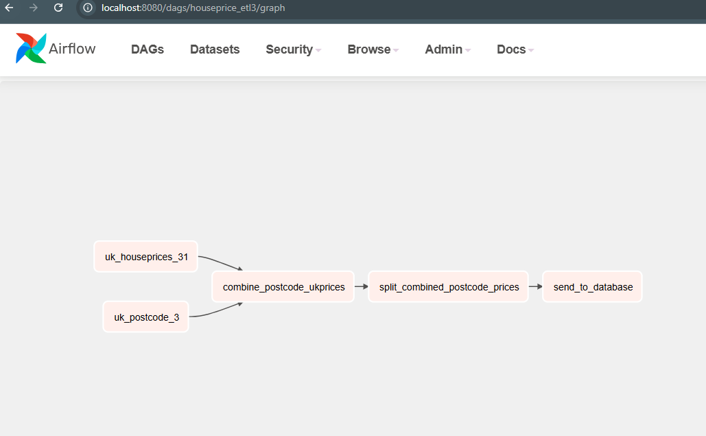

### Implementing Pandas ETL in Airflow
1. converting the houseprices etl to dags in airflow

2. Need to create _config.yaml_ for database to create and load in transformed data (In this case postgrest).
  - user: "yourdatabaseuser"
  - database: "yourdatabasename"
  - password: "yourdatabasepassword"

3. Run via `docker compose up` and airflow UI should on `http://localhost:8080`
  - Created DAG
   